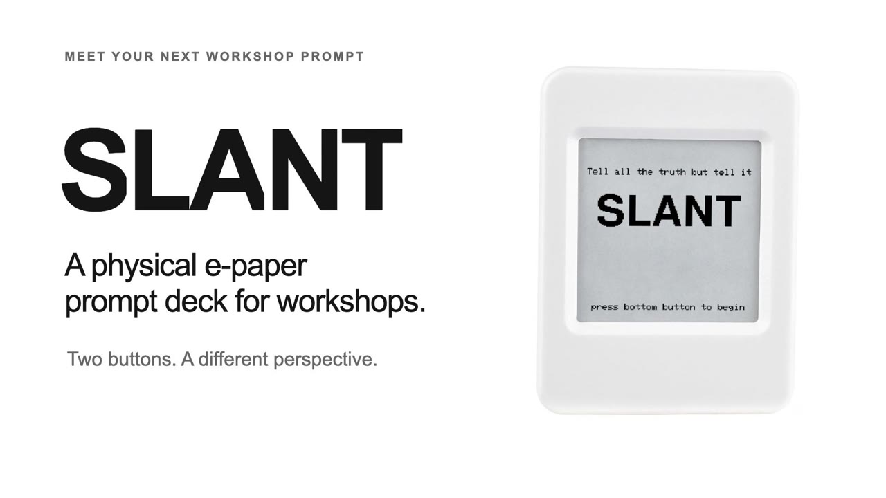
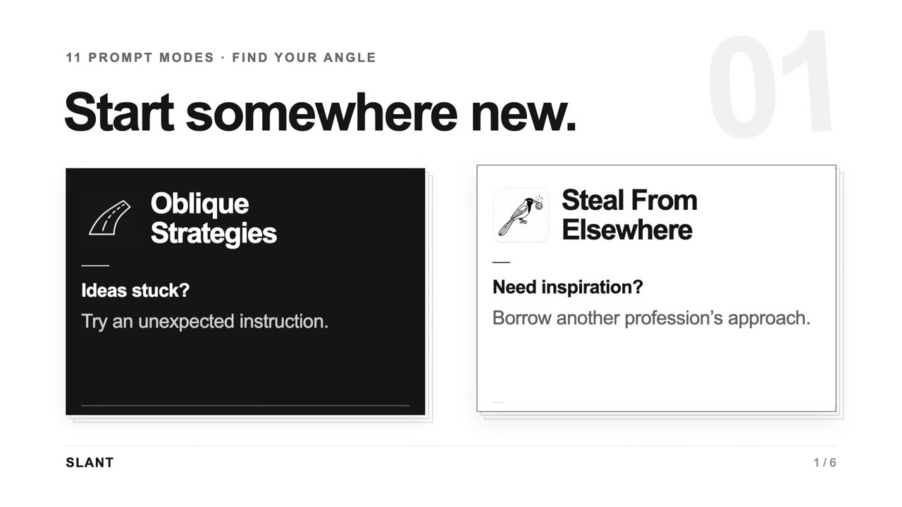
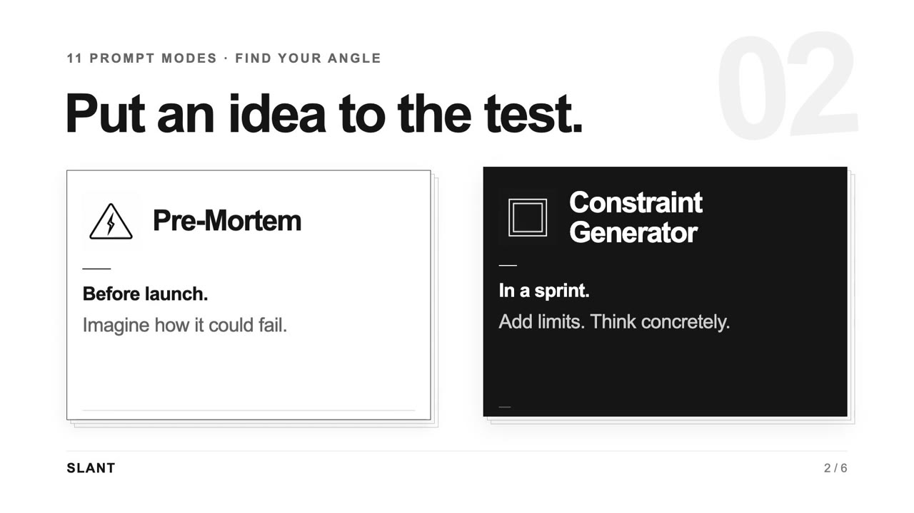
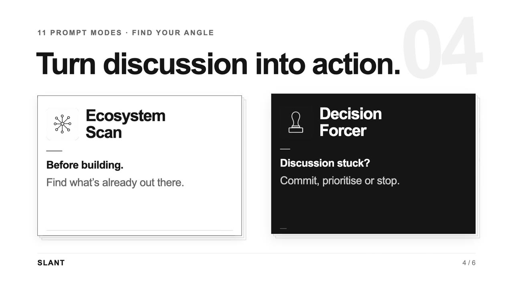
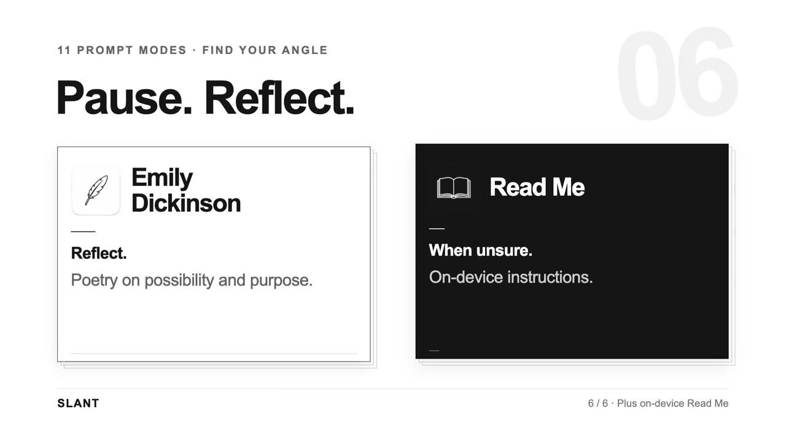

# Slant

**A pocket deck of facilitation prompts on a 1.54" e-paper screen.** Press a button, get a card: a pre-mortem question, a constraint, a stakeholder to argue as, a line from Emily Dickinson. Built for workshops, innovation and charity work. It runs for a very long time on a small battery, works fully offline, and the screen keeps its image with no power.

The name comes from Dickinson: *"Tell all the truth but tell it slant."*

## See it



| 1. Top button: choose a mode | 2. Bottom button: draw a card |
|---|---|
|  |  |

The twelve modes:

| | |
|---|---|
|  |  |
|  |  |
|  |  |

Leave it on the Splash screen and it makes a good gift:


## Buy the hardware

Slant runs on the **Waveshare ESP32-S3-ePaper-1.54** board:

**https://www.waveshare.com/esp32-s3-epaper-1.54.htm?sku=32298**

You also need a USB-C cable that carries data (many charge-only cables don't). A small LiPo battery is optional; check the Waveshare page for the right connector.

## The quickest way: point your agent at this page

If you use an AI coding agent (Claude Code, Codex, Cursor, or similar), you don't have to do any of the steps below yourself. Plug the board into your computer and tell the agent:

> Read https://github.com/greencat667/slant and flash Slant onto the ESP32 board plugged into this computer.

The agent can clone the repo, install the tools, compile and flash. The only things it can't do are physical: you may need to hold the BOOT button while plugging the board in (see [Download mode](#download-mode)).

## How to use it

Two buttons, no timing tricks. Every action is a single press.

| Button | What it does |
|---|---|
| **Top (BOOT)** | Next menu item. Shows an icon and the name. |
| **Bottom (PWR)** | Draw a card in the current mode. |

Between presses the board is in deep sleep. The screen keeps its image, so it looks the same until you press something. A press takes a few seconds to refresh. That's the e-paper, not a fault.

The menu cycles through the modes and ends on **Splash**, the SLANT title screen. Leave it on Splash if you're giving the device as a gift. Pressing the bottom button from there starts the deck.

### Modes

| Mode | What you get |
|---|---|
| Read Me | Paged on-device explainer (sequential) |
| Oblique Strategies | Original lateral-thinking prompts, in the spirit of Eno and Schmidt's deck |
| Pre-Mortem | A specific way your project could fail |
| Stakeholder Perspective | "Argue this as a..." trustee, volunteer, funder, sceptic |
| Constraint Generator | An artificial constraint for a time-boxed sprint |
| Steal From Elsewhere | How would an unexpected profession solve this? |
| Values Check | Who might be hurt or overlooked |
| Ecosystem Scan | Who is already solving part of this? |
| Decision Forcer | Forces a commit-or-kill decision now |
| Futures Thinking | Three steps: a weak signal, a scenario question, then the opposite |
| Scaling | Scale deep, out and up, one lens per press |
| Emily Dickinson | Her actual words (public domain) |

## Install it yourself

### 1. Install the tools

Install [arduino-cli](https://arduino.github.io/arduino-cli/latest/installation/) (on macOS: `brew install arduino-cli`).

On a Mac with Apple silicon you may also need Rosetta, because one of Arduino's helper tools is Intel-only. If compiling fails with "bad CPU type in executable", run:

```bash
softwareupdate --install-rosetta --agree-to-license
```

### 2. Get the code

```bash
git clone https://github.com/greencat667/slant.git
cd slant
```

### 3. Flash

Plug the board in, then run:

```bash
./flash.sh
```

The script installs the ESP32 core and the Adafruit GFX library if needed, lists the boards it can see, asks for the port, then compiles and uploads. You can also pass the port directly: `./flash.sh /dev/cu.usbmodem1101`.

The manual equivalent:

```bash
arduino-cli core install esp32:esp32@3.3.11 --additional-urls https://espressif.github.io/arduino-esp32/package_esp32_index.json
arduino-cli lib install "Adafruit GFX Library"
arduino-cli compile --fqbn "esp32:esp32:esp32s3:PSRAM=opi,FlashSize=8M" slant
arduino-cli upload  --fqbn "esp32:esp32:esp32s3:PSRAM=opi,FlashSize=8M" -p <your-port> slant
```

Ports look like `/dev/cu.usbmodem…` on macOS, `/dev/ttyACM0` on Linux and `COM5` on Windows. On Linux you may need to add yourself to the `dialout` group.

When it finishes, press PWR or BOOT to wake the board. After a fresh flash you should see the SLANT splash.

### Download mode

Slant puts the board into deep sleep between presses, and **deep sleep switches off the USB port**. If `arduino-cli` can't find a port, or says the port doesn't exist, put the board into download mode:

1. Unplug the USB cable.
2. Hold the **BOOT** button.
3. Plug the cable in while still holding BOOT.
4. Wait about 3 seconds, then release BOOT.
5. Run the flash step straight away.

If the port appears and then vanishes, just run the upload again.

## Troubleshooting

| Symptom | Try |
|---|---|
| No serial port appears | Use a data-capable cable. Plug into the computer directly, not a hub or dock. Use download mode. |
| "bad CPU type in executable" (macOS) | Install Rosetta (see above). |
| Port vanishes during upload | Run the upload again. |
| Screen looks frozen | Wait 5 seconds after a press: e-paper refreshes slowly. |
| Green light on, buttons do nothing | Reflash in download mode. |

## Make it your own

- **Change the prompts:** each mode's cards are plain lists in `slant/*_data.h`. Edit, add or remove lines and reflash.
- **Add a mode:** add a data file and an entry in `slant/modes.h`. The menu picks it up.
- **Icons:** the menu icons are 96x96 bitmaps in `slant/mode_icons.h`. `tools/gen_icons.py` is the (optional) generator I used.
- **Pins:** the board's pin map is in `slant/user_config.h`.

## How it works

- Deep sleep between presses; wake on BOOT or PWR. The menu position lives in RTC memory, so it survives sleep with no flash writes.
- The e-paper image is drawn to a 200x200 canvas, pushed to the panel, then the panel is powered off.
- No WiFi, no accounts, no network code at all.
- Board: Waveshare ESP32-S3-ePaper-1.54 (ESP32-S3, 8 MB flash, 8 MB PSRAM).

## Licence

MIT for this project's code (see `LICENSE`). Third-party code and content are listed in `NOTICE.md`.
